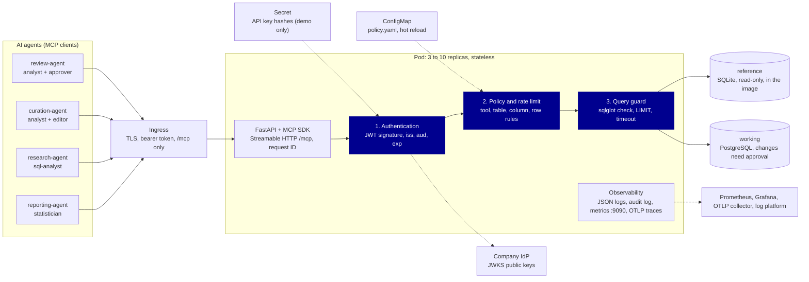

# Titanic MCP Server – Specification

MLOps team · 2026-11-18

> This file is the source of truth for the specification. Change it with a pull request. Requirement IDs (for example QS-04) appear in the test names.

## 0. Document control

This specification is a draft for review. It gives the full design of the Titanic MCP Server before the team starts the implementation.

| Item | Value |
| --- | --- |
| Document version | 0.2 (decisions OP-01 to OP-09 applied) |
| Status | Approved. Release 1.0.0 is implemented. Refer to section 16 for the deviations. |
| Language | ASD-STE100 Simplified Technical English (Issue 9) |
| Owner | MLOps team |
| Readers | MLOps team, platform team, security team, teams that operate AI agents |

**Rules for this document:**

- Each requirement has an identifier (for example, FR-01). Use this identifier in tickets, tests and commits.
- "MUST" shows a mandatory requirement. "SHOULD" shows a recommended requirement.
- Each requirement MUST have one or more automated tests before release.
- Write comments on this document to change a requirement. Do not change an identifier after approval.

## 1. Purpose and scope

The Titanic MCP Server lets AI agents of other teams read the Titanic database through the Model Context Protocol (MCP). The server controls which agent can see which data. It records each access, and it operates in Kubernetes.

**In scope:**

- An MCP server in Python 3.12 with FastAPI as the HTTP framework.
- MCP tools, resources and prompts for read access to the Titanic database.
- Authentication of each agent, and permissions for each agent (tools, tables, columns, rows).
- Structured error logs, audit logs, metrics, traces and alerts.
- A container image and a Helm chart for Kubernetes.
- A CI/CD pipeline with tests, security scans and quality gates.

**Out of scope (version 1.0):**

- Free write SQL. Agents change data only through change requests with an approval (section 7a).
- An identity provider. The server uses an identity provider that the platform team operates.
- A user interface for humans.
- Machine learning models (for example, a survival prediction).

## 2. Terms and abbreviations

| Term | Meaning |
| --- | --- |
| Agent | An AI application of another team. It connects to the server as an MCP client. |
| MCP | Model Context Protocol. An open protocol that connects AI applications to tools and data. |
| Tool | An MCP function that an agent can call (for example, `run_query`). |
| Resource | MCP data that an agent can read by URI (for example, the schema). |
| Role | A named set of permissions. An agent has one or more roles. |
| Policy | A YAML file that gives roles to agents and permissions to roles. |
| JWT | JSON Web Token. A signed token that identifies an agent. |
| IdP | Identity provider (for example, Keycloak or Microsoft Entra ID). |
| RED metrics | Rate, errors and duration of requests. |
| SLO | Service level objective. A target value for a metric. |
| HPA | Kubernetes Horizontal Pod Autoscaler. |
| PDB | Kubernetes PodDisruptionBudget. |

## 3. Data source

The data source is the SQLite file `titanic.db` from the repository [SQLite\_databases\_for\_learning\_data\_science](https://github.com/davidjamesknight/SQLite_databases_for_learning_data_science/blob/main/titanic.db). The MLOps team examined the file on 2026-11-18. The file has 8 tables, 891 passenger rows, no primary keys, no foreign keys and no indexes.

| Table | Rows | Columns | Content |
| --- | --- | --- | --- |
| `Observation` | 891 | `survived`, `pclass`, `age`, `sibsp`, `parch`, `fare`, `adult_male`, `alone`, `sex_id`, `embarked_id`, `class_id`, `who_id`, `deck_id`, `embark_town_id`, `alive_id` | One row for each passenger |
| `Sex` | 2 | `sex_id`, `sex` | female, male |
| `Class` | 3 | `class_id`, `class` | First, Second, Third |
| `Who` | 3 | `who_id`, `who` | child, man, woman |
| `Deck` | 8 | `deck_id`, `deck` | A to G, and -1 (unknown) |
| `Embarked` | 4 | `embarked_id`, `embarked` | C, Q, S, and -1 (unknown) |
| `EmbarkTown` | 4 | `embark_town_id`, `embark_town` | Cherbourg, Queenstown, Southampton, and -1 (unknown) |
| `Alive` | 2 | `alive_id`, `alive` | no, yes |

**Data quality facts:**

- `age` is NULL in 177 rows.
- `deck_id` is -1 (unknown) in 688 rows.
- `embarked_id` is -1 (unknown) in 2 rows.
- The data has no passenger names and no personal identifiers.
- SHA-256 checksum of the examined file: `aa9cf7683387fefae3759a6d51fd03c917836fdc9c61299ffea15de5bf5f327d`.

**Requirements:**

| ID | Requirement |
| --- | --- |
| DS-01 | The build MUST download the file from a pinned commit and MUST compare the SHA-256 checksum. If the checksum is different, the build MUST stop. |
| DS-02 | The server MUST open the database in read-only mode (`file:...?mode=ro&immutable=1`) and MUST set `PRAGMA query_only=ON`. |
| DS-03 | The server MUST give the view `passengers` to agents. This view joins `Observation` with all lookup tables and shows text values, not IDs. The server creates it as a TEMP VIEW on each connection, so the file does not change. |
| DS-04 | The view MUST show the value NULL in place of the code -1. |
| DS-05 | The server MUST use a database adapter interface. A change to PostgreSQL later MUST NOT need changes in the MCP tools. |

## 4. Architecture

The server is one stateless FastAPI application. It contains the MCP endpoint, the security layer and the database layer. Because the server keeps no session state, Kubernetes can start and stop pods at any time.



A request goes down through the pod. The 3 marked layers can stop it before it reaches the database.

**Request sequence (each MCP tool call):**

1. The agent sends an HTTPS request with a bearer token to `/mcp`.
2. The ingress controller ends TLS and sends the request to a pod.
3. The middleware gives a request ID and starts a trace span.
4. The authentication layer validates the token and finds the agent identity.
5. The rate limiter examines the request budget of the agent.
6. The policy engine examines the permission for the tool, the tables, the columns and the rows.
7. The query layer validates and rewrites the SQL, then runs it on the read-only database.
8. The server writes an audit event, updates the metrics and sends the result.

**Technology stack:**

| Layer | Technology | Reason |
| --- | --- | --- |
| Language | Python 3.12 | Team standard. Long support period. |
| HTTP framework | FastAPI with Uvicorn | Proven framework. Async. Pydantic validation. |
| MCP | Official MCP Python SDK (`mcp`, FastMCP), Streamable HTTP transport in stateless mode, mounted at `/mcp` | Standard MCP transport for remote servers. No sticky sessions necessary. |
| Validation | Pydantic v2, pydantic-settings | Typed inputs, outputs and configuration. |
| SQL validation | sqlglot | Parses SQL into a syntax tree. Lets the server allow only safe statements. |
| Database access | SQLAlchemy 2.0 Core with aiosqlite | Adapter for SQLite now and PostgreSQL later. |
| Authentication | PyJWT with JWKS, OAuth 2.1 resource server | Agrees with the MCP authorization specification. |
| Logs | structlog (JSON to stdout) | Machine-readable logs for Loki or Elasticsearch. |
| Metrics | prometheus-client | Kubernetes standard. |
| Traces | OpenTelemetry SDK, OTLP exporter | Vendor-neutral traces. |
| Packages | uv with lock file | Reproducible builds. |
| Container | Multi-stage build, distroless or Chainguard Python base | Small image, few CVEs. |
| Deployment | Helm 3 chart, Kubernetes 1.30 or later | Team standard. |

## 5. MCP interface

The server gives 6 tools, 3 resources and 1 prompt. All tools are read-only. An agent sees only the tools that its roles permit.

**Protocol requirements:**

| ID | Requirement |
| --- | --- |
| MCP-01 | The server MUST use the Streamable HTTP transport at the path `/mcp`, in stateless mode with JSON responses. |
| MCP-02 | The server MUST support the current stable MCP specification version (2025-11-25 at the time of writing) and MUST negotiate the version with the client. |
| MCP-03 | `tools/list` MUST show only the tools that the agent has permission to call. |
| MCP-04 | Each tool MUST declare an `inputSchema` and an `outputSchema`. Each result MUST contain `structuredContent` and a JSON text copy for old clients. |
| MCP-05 | Each tool MUST set the annotations `readOnlyHint=true` and `idempotentHint=true`. |
| MCP-06 | The server MUST validate the `Origin` header and MUST reject unknown origins (DNS rebinding protection). |
| MCP-07 | Each tool description MUST tell the agent the limits (maximum rows, allowed columns), so that the agent can make correct calls. |

**Tools:**

| Tool | Function | Input (main fields) | Necessary scope |
| --- | --- | --- | --- |
| `list_tables` | Shows the tables and views that the agent can read, with a short description. | none | `schema:read` |
| `describe_table` | Shows the columns, data types, NULL counts and value lists of one table. | `table` | `schema:read` |
| `get_sample_rows` | Shows example rows of one table. | `table`, `limit` (1 to 20) | `data:read` |
| `query_passengers` | Finds passenger rows with structured filters. No SQL is necessary. | `filters[]` (column, operator, value), `columns[]`, `order_by`, `limit`, `offset` | `data:read` |
| `aggregate_passengers` | Calculates statistics by groups (for example, survival rate by class and sex). | `group_by[]`, `metrics[]` (count, avg, sum, min, max), `filters[]` | `data:aggregate` |
| `run_sql` | Runs one read-only SELECT statement. Refer to section 7. | `sql`, `limit` | `sql:execute` |

**Tool result (all data tools):**

```json
{
  "columns": ["class", "sex", "survival_rate"],
  "rows": [["First", "female", 0.968]],
  "row_count": 1,
  "truncated": false,
  "masked_columns": [],
  "request_id": "01JD3Y6Q2K7M8N9P0R1S2T3V4W"
}
```

**Resources:**

| URI | Content | Necessary scope |
| --- | --- | --- |
| `titanic://schema` | The schema of all tables and views that the agent can read (JSON). | `schema:read` |
| `titanic://dataset/info` | Source, license, row counts, data quality facts and checksum. | `schema:read` |
| `titanic://me` | The identity, roles, scopes and limits of the calling agent. | none |

**Prompts:**

| Name | Function |
| --- | --- |
| `analyze_survival` | Gives the agent a template to analyze survival by one or more dimensions with `aggregate_passengers`. |

**Other HTTP endpoints (not MCP):**

| Path | Port | Function | Authentication |
| --- | --- | --- | --- |
| `/healthz/live` | 8000 | Liveness probe | none |
| `/healthz/ready` | 8000 | Readiness probe (database and JWKS available) | none |
| `/version` | 8000 | Version, Git commit, build date, data checksum | none |
| `/.well-known/oauth-protected-resource` | 8000 | OAuth protected resource metadata (RFC 9728) | none |
| `/metrics` | 9090 | Prometheus metrics. Not available through the ingress. | none, network policy only |

## 6. Authentication and permissions

Each agent has its own identity and one or more roles. The server denies all access that a role does not permit (deny by default). The server examines permissions on 4 levels: tool, table, column and row.

**Authentication:**

| ID | Requirement |
| --- | --- |
| AUTH-01 | In production, the server MUST accept only OAuth 2.1 bearer tokens (JWT). Each agent gets a client ID from the IdP and uses the client credentials flow. |
| AUTH-02 | The server MUST validate the signature (JWKS), `iss`, `aud`, `exp` and `nbf` of each token. `aud` MUST be the URI of this server (RFC 8707). |
| AUTH-03 | The server MUST keep the JWKS in a cache for 10 minutes and MUST load it again when it finds an unknown key ID. |
| AUTH-04 | The server MUST send HTTP 401 with a `WWW-Authenticate` header that points to `/.well-known/oauth-protected-resource`, if the token is missing or not valid. |
| AUTH-05 | For local tests and the presentation, the server MAY accept static API keys. The server stores only SHA-256 hashes of the keys. The server MUST NOT start in API key mode when `TMCP_ENV=production`. |
| AUTH-06 | The server MUST NOT write tokens or API keys to logs, traces or error messages. |

**Roles (proposal for version 1.0):**

| Role | Tools | Data access | Limits |
| --- | --- | --- | --- |
| `schema-reader` | `list_tables`, `describe_table`, resources | Schema only, no rows | 60 requests/min |
| `statistician` | `schema-reader` + `aggregate_passengers` | Aggregates only. Each group MUST contain 5 or more rows; the server removes smaller groups. | 60 requests/min |
| `analyst` | `statistician` + `get_sample_rows`, `query_passengers` | Rows of the view `passengers`. The column `fare` is masked. | 120 requests/min, 500 rows per call |
| `sql-analyst` | `analyst` + `run_sql` | All tables and columns | 120 requests/min, 1000 rows per call, 5 s timeout |

**Policy file (example):**

```yaml
version: 1
roles:
  analyst:
    tools: [list_tables, describe_table, get_sample_rows, query_passengers, aggregate_passengers]
    tables:
      passengers:
        columns: {deny: [fare]}
        row_filter: null          # example: "class = 'Third'"
    limits: {max_rows: 500, requests_per_minute: 120, max_concurrency: 4}
agents:
  churn-agent:                    # value of the JWT claim "azp"
    roles: [analyst]
  reporting-agent:
    roles: [statistician]
```

**Authorization:**

| ID | Requirement |
| --- | --- |
| PERM-01 | The policy file MUST be a Kubernetes ConfigMap. The server MUST validate it with a Pydantic schema at start. If it is not valid, the server MUST NOT start. |
| PERM-02 | The server MUST load a changed policy file without a restart (in 60 seconds or less). If the new file is not valid, the server MUST keep the old policy, write an error log and increase the metric `tmcp_policy_reload_errors_total`. |
| PERM-03 | The server MUST find the roles of an agent from the policy file. It MAY also use the JWT claim `roles`, if `TMCP_TRUST_TOKEN_ROLES=true`. |
| PERM-04 | If an agent has more than one role, the permissions MUST be the union of the roles. For the limits, the highest value applies. |
| PERM-05 | The server MUST apply column and row rules to all tools, also to `run_sql`. It rewrites each query with sqlglot: it replaces each table with a filtered subquery and removes or rejects denied columns. `SELECT *` gives only the permitted columns. |
| PERM-06 | A denied call MUST give the error `PERMISSION_DENIED` (refer to section 8) and MUST write an audit event with the decision `deny`. |
| PERM-07 | The resource `titanic://me` MUST show the effective permissions of the agent, so that agent developers can find permission problems. |

## 7. Query safety

The server runs only one validated SELECT statement for each call. It does this on a read-only connection with a row limit and a timeout. The validation uses a syntax tree (sqlglot), not text patterns.

| ID | Requirement |
| --- | --- |
| QS-01 | `run_sql` MUST accept only one statement. The statement MUST be a `SELECT` (a `WITH ... SELECT` is permitted). |
| QS-02 | The server MUST reject `PRAGMA`, `ATTACH`, `DETACH`, `VACUUM`, all DDL and all DML. It MUST also reject the functions `load_extension`, `readfile`, `writefile` and `randomblob`. |
| QS-03 | Each table in the query MUST be in the table list of the agent. The server MUST reject `sqlite_master` and all `sqlite_*` tables. |
| QS-04 | The server MUST add a `LIMIT` or make it smaller, so that it is not more than `max_rows` of the agent. The result MUST show `truncated=true` if more rows are available. |
| QS-05 | The server MUST stop a query after the timeout (default 5 s). It uses the SQLite progress handler for this. |
| QS-06 | The maximum length of the SQL text MUST be 10 000 characters. The maximum size of a result MUST be 1 MB. |
| QS-07 | Structured tools (`query_passengers`, `aggregate_passengers`) MUST use only bound parameters. They MUST NOT put agent values into SQL text. |
| QS-08 | The server MUST use an allow-list for filter operators: `=`, `!=`, `<`, `<=`, `>`, `>=`, `in`, `between`, `is_null`, `like`. |
| QS-09 | The test suite MUST contain a set of 50 or more SQL injection and bypass tests. All of them MUST fail with `QUERY_REJECTED`. |

## 7a. Write access (OP-01)

Agents can change data in version 1.0, but only in a separate writable dataset and only with the approval of a second agent. The original data never changes.

**Datasets:**

| Dataset | Storage | Access |
| --- | --- | --- |
| `reference` | Original `titanic.db`, read-only SQLite in the image | Read only. `run_sql` works only on this dataset. |
| `working` | PostgreSQL. The first replica copies the 891 rows of `passengers` at start. | Read with `query_passengers`, `aggregate_passengers`, `describe_table` (`dataset=working`). Write only through change requests. |

**Change request sequence:**

1. An agent with the role `editor` calls `propose_passenger_insert`, `propose_passenger_update` or `propose_passenger_delete` with a reason.
2. The server validates the values and keeps a copy of the current row. The status is `pending`.
3. A different agent with the role `approver` calls `review_change_request` with `approve` or `reject`.
4. On approval, the server applies the change in the same transaction. If the row changed after the proposal, the status is `conflict` and the data does not change.

**Write tools:**

| Tool | Function | Role |
| --- | --- | --- |
| `propose_passenger_insert` | Propose a new passenger | `editor` |
| `propose_passenger_update` | Propose changes to columns of one passenger | `editor` |
| `propose_passenger_delete` | Propose to delete one passenger | `editor` |
| `list_change_requests` | List change requests (editors see only their own) | `editor`, `approver` |
| `get_change_request` | Show one change request | `editor`, `approver` |
| `review_change_request` | Approve or reject a pending change request | `approver` |

| ID | Requirement |
| --- | --- |
| WR-01 | The reference dataset MUST NOT change. Each write MUST go to the working dataset. |
| WR-02 | Each write MUST be a change request with a reason of 10 or more characters. |
| WR-03 | The reviewer MUST be a different agent than the requester (four-eyes rule). The database layer MUST also examine this rule. |
| WR-04 | The server MUST apply an approved change in the approval transaction. It MUST set the status `conflict` if the row changed after the proposal. |
| WR-05 | The server MUST validate the values: permitted values, ranges, and the rules `who`/`sex`/`adult_male` and `alone`/`sibsp`/`parch`. |
| WR-06 | A pending change request MUST expire after `TMCP_CHANGE_REQUEST_TTL_HOURS` (default 168 hours). |
| WR-07 | The schema bootstrap MUST be safe with many replicas (PostgreSQL advisory lock) and MUST copy the rows only once. |
| WR-08 | Each status change MUST increase the metric `tmcp_change_requests_total{status}`. |

## 8. Error handling and logging

The server gives each error a stable code and a request ID. It writes all logs as JSON lines to stdout. Kubernetes collects them. Audit events go to a separate log stream.

**Error model:**

The server uses two types of errors, as the MCP specification tells:

- **Protocol errors** (JSON-RPC errors): for example, an unknown tool or a request that is not valid.
- **Tool errors** (a result with `isError=true`): for example, a denied permission or a rejected query. The agent can read these errors and correct its next call.

```json
{
  "isError": true,
  "structuredContent": {
    "error": {
      "code": "QUERY_REJECTED",
      "message": "The table 'sqlite_master' is not permitted.",
      "hint": "Use the tool list_tables to see the permitted tables.",
      "request_id": "01JD3Y6Q2K7M8N9P0R1S2T3V4W"
    }
  }
}
```

| Code | Cause | HTTP / MCP | Log level |
| --- | --- | --- | --- |
| `UNAUTHENTICATED` | Token missing, not valid or expired | HTTP 401 | WARNING |
| `PERMISSION_DENIED` | The role does not permit the tool, table, column or row | Tool error | WARNING |
| `RATE_LIMITED` | Too many requests or too many parallel requests | Tool error, `retry_after_s` | WARNING |
| `INVALID_ARGUMENT` | The input does not agree with the input schema | JSON-RPC -32602 | INFO |
| `QUERY_REJECTED` | The SQL validation rejected the statement | Tool error | WARNING |
| `QUERY_TIMEOUT` | The query used more time than the limit | Tool error | WARNING |
| `RESULT_TOO_LARGE` | The result is larger than 1 MB | Tool error | INFO |
| `DATABASE_UNAVAILABLE` | The database file cannot be opened | Tool error, HTTP 503 on readiness | ERROR |
| `INTERNAL` | An unexpected exception | JSON-RPC -32603 | ERROR, with stack trace |

**Logging requirements:**

| ID | Requirement |
| --- | --- |
| LOG-01 | Each log line MUST be one JSON object with these fields: `timestamp` (UTC, ISO 8601), `level`, `logger`, `event`, `request_id`, `trace_id`, `span_id`, `agent_id`, `tool`, `duration_ms`, `service_version`. |
| LOG-02 | The server MUST give a request ID (ULID) to each request. It MUST accept an `X-Request-ID` header from the client and MUST send the ID back in the response. |
| LOG-03 | An `INTERNAL` error MUST write the stack trace to the log. The response to the agent MUST NOT contain the stack trace, SQL internals or file paths. |
| LOG-04 | The log level MUST be configurable with `TMCP_LOG_LEVEL`. The default is `INFO`. |
| LOG-05 | The server MUST remove secrets from logs with a redaction processor (headers `Authorization`, `Cookie`, fields `token`, `api_key`, `password`). |
| LOG-06 | The server SHOULD send `ERROR` events to Sentry (or a similar tool), if `TMCP_SENTRY_DSN` is set. |

**Audit log:**

| ID | Requirement |
| --- | --- |
| AUD-01 | The server MUST write one audit event for each tool call and each resource read, also for denied calls. |
| AUD-02 | An audit event MUST contain: `timestamp`, `request_id`, `agent_id`, `roles`, `tool`, `arguments` (SQL text included, values longer than 2 000 characters cut), `decision` (`allow` / `deny`), `deny_reason`, `row_count`, `truncated`, `duration_ms`, `client_ip`. |
| AUD-03 | Audit events MUST use the logger name `audit`, so that the log platform can keep them in a separate index for 365 days. |
| AUD-04 | The server MUST NOT write result rows to the audit log. |

## 9. Monitoring

The server gives Prometheus metrics, OpenTelemetry traces and health probes. The Helm chart contains the alert rules and a Grafana dashboard, so that monitoring starts with the first deployment.

**Metrics (port 9090, path `/metrics`):**

| Metric | Type | Labels | Function |
| --- | --- | --- | --- |
| `tmcp_requests_total` | Counter | `tool`, `status`, `agent_id` | Number of MCP calls |
| `tmcp_request_duration_seconds` | Histogram | `tool` | Duration of MCP calls |
| `tmcp_query_duration_seconds` | Histogram | `tool` | Duration of database queries |
| `tmcp_query_rows` | Histogram | `tool` | Number of rows for each result |
| `tmcp_auth_failures_total` | Counter | `reason` | Failed authentications |
| `tmcp_permission_denied_total` | Counter | `agent_id`, `tool` | Denied calls |
| `tmcp_rate_limited_total` | Counter | `agent_id` | Calls stopped by the rate limiter |
| `tmcp_query_rejected_total` | Counter | `reason` | SQL statements rejected by the validation |
| `tmcp_inflight_requests` | Gauge | none | Requests in progress |
| `tmcp_policy_reload_errors_total` | Counter | none | Policy files that were not valid |
| `tmcp_build_info` | Gauge | `version`, `commit`, `data_sha256`, `policy_version` | Build and configuration data |

The label `agent_id` MUST have only the values from the policy file, or the value `unknown`. This keeps the number of time series small.

**Service level objectives (proposal):**

| SLO | Target | Measurement window |
| --- | --- | --- |
| Availability (calls without `INTERNAL` or `DATABASE_UNAVAILABLE`) | 99.5 % | 30 days |
| Latency of tool calls, 95th percentile | Less than 500 ms | 30 days |

**Alerts (PrometheusRule in the Helm chart):**

| Alert | Condition | Severity |
| --- | --- | --- |
| `TmcpHighErrorRate` | `INTERNAL` errors more than 2 % of calls for 5 min | critical |
| `TmcpHighLatency` | p95 latency more than 1 s for 10 min | warning |
| `TmcpAuthFailureSpike` | More than 20 auth failures per minute for 5 min | warning (possible attack) |
| `TmcpPermissionDeniedSpike` | More than 10 denied calls per minute from one agent for 10 min | info (agent configuration problem) |
| `TmcpPodsNotReady` | Fewer than 2 ready pods for 5 min | critical |
| `TmcpPolicyReloadFailed` | `tmcp_policy_reload_errors_total` increases | warning |
| `TmcpErrorBudgetBurn` | Error budget burn rate more than 14 in 1 h | critical |

**Monitoring requirements:**

| ID | Requirement |
| --- | --- |
| MON-01 | The Helm chart MUST contain a `ServiceMonitor` (Prometheus Operator) and a `PrometheusRule` with the alerts above. |
| MON-02 | The repository MUST contain a Grafana dashboard (JSON) with: calls per tool, error rate, latency p50/p95/p99, calls per agent, denied calls, pod resources. |
| MON-03 | The server MUST make trace spans for: HTTP request, authentication, policy decision, SQL validation, database query. It MUST send them with OTLP to `TMCP_OTEL_ENDPOINT`. |
| MON-04 | The default trace sample rate MUST be 10 %. The server MUST always keep traces with errors. |
| MON-05 | The readiness probe MUST fail if the database cannot be read or the JWKS is not available. The liveness probe MUST examine only the process. |
| MON-06 | Each alert MUST have a link to a runbook in `docs/runbooks/`. |

## 10. Configuration and secrets

The server reads all configuration from environment variables with the prefix `TMCP_`. The server validates the configuration at start. If a value is not valid, the server stops with a clear error message.

| Variable | Default | Function |
| --- | --- | --- |
| `TMCP_ENV` | `development` | `development`, `staging` or `production`. Production enables strict rules (AUTH-05). |
| `TMCP_DB_PATH` | `/app/data/titanic.db` | Path of the database file |
| `TMCP_POLICY_PATH` | `/etc/tmcp/policy.yaml` | Path of the policy file (ConfigMap) |
| `TMCP_AUTH_MODE` | `jwt` | `jwt` or `api_key` |
| `TMCP_JWT_ISSUER` | none | Expected `iss` value |
| `TMCP_JWT_AUDIENCE` | none | Expected `aud` value (URI of the server) |
| `TMCP_JWKS_URL` | none | URL of the IdP key set |
| `TMCP_AGENT_ID_CLAIM` | `azp` | JWT claim that contains the agent ID |
| `TMCP_TRUST_TOKEN_ROLES` | `false` | Use the JWT claim `roles` (PERM-03) |
| `TMCP_API_KEYS_FILE` | none | File with API key hashes (Secret), only for `api_key` mode |
| `TMCP_ALLOWED_ORIGINS` | empty | Permitted `Origin` values (MCP-06) |
| `TMCP_QUERY_TIMEOUT_S` | `5` | Default query timeout |
| `TMCP_LOG_LEVEL` | `INFO` | Log level |
| `TMCP_OTEL_ENDPOINT` | none | OTLP endpoint. No value disables traces. |
| `TMCP_TRACE_SAMPLE_RATE` | `0.1` | Trace sample rate |
| `TMCP_SENTRY_DSN` | none | Optional error tracking |
| `TMCP_METRICS_PORT` | `9090` | Port of the metrics endpoint |

**Secrets:**

- Kubernetes Secrets contain the API key hashes and the Sentry DSN. In production, the External Secrets Operator SHOULD supply them from the central vault.
- The JWT mode needs no secret in the server. The server uses only the public keys of the IdP.
- The repository MUST NOT contain secrets. The CI pipeline MUST scan for secrets (gitleaks).

## 11. Container and Kubernetes deployment

The server is one container image that contains the code and the read-only database. A Helm chart deploys it to Kubernetes with 3 or more replicas. Because the pods keep no state, a rolling update causes no downtime.

**Container image:**

| ID | Requirement |
| --- | --- |
| CON-01 | The Dockerfile MUST use a multi-stage build: stage 1 installs the packages with `uv sync --frozen`, stage 2 downloads and verifies the database (DS-01), stage 3 is the runtime image. |
| CON-02 | The runtime image MUST be a distroless or Chainguard Python 3.12 image without a shell and without a package manager. |
| CON-03 | The process MUST run as a non-root user (UID 10001). All files MUST be read-only for this user. |
| CON-04 | The image MUST work with a read-only root file system. Temporary files go to an `emptyDir` volume at `/tmp`. |
| CON-05 | The server MUST stop cleanly on `SIGTERM`: it stops new requests, completes open requests in 20 s or less, then stops. |
| CON-06 | Image tags MUST be the semantic version and the Git commit (for example, `1.0.0` and `sha-3f2a9c1`). The tag `latest` MUST NOT be used in Kubernetes. |
| CON-07 | The CI pipeline MUST sign the image (cosign) and MUST attach an SBOM (syft, SPDX format). |
| CON-08 | The image MUST have no CRITICAL vulnerabilities and no HIGH vulnerabilities with an available fix (Trivy scan). |

**Dockerfile (outline):**

```dockerfile
FROM ghcr.io/astral-sh/uv:python3.12-bookworm-slim AS build
WORKDIR /app
COPY pyproject.toml uv.lock ./
RUN uv sync --frozen --no-dev --no-install-project
COPY src/ ./src/
RUN uv sync --frozen --no-dev

FROM curlimages/curl AS data
ARG DB_COMMIT DB_SHA256
RUN curl -fsSL -o /tmp/titanic.db \
  https://raw.githubusercontent.com/davidjamesknight/SQLite_databases_for_learning_data_science/${DB_COMMIT}/titanic.db \
  && echo "${DB_SHA256}  /tmp/titanic.db" | sha256sum -c -

FROM cgr.dev/chainguard/python:latest-3.12 AS runtime   # pin by digest in the real file
WORKDIR /app
COPY --from=build /app/.venv /app/.venv
COPY --from=build /app/src /app/src
COPY --from=data /tmp/titanic.db /app/data/titanic.db
USER 10001
EXPOSE 8000 9090
ENTRYPOINT ["/app/.venv/bin/uvicorn", "tmcp.main:app", "--host", "0.0.0.0", "--port", "8000"]
```

**Kubernetes resources (Helm chart `charts/titanic-mcp`):**

| Resource | Configuration |
| --- | --- |
| `Deployment` | 3 replicas. `RollingUpdate` with `maxUnavailable: 0`, `maxSurge: 1`. `topologySpreadConstraints` across zones and nodes. |
| Pod security | `runAsNonRoot: true`, `runAsUser: 10001`, `readOnlyRootFilesystem: true`, `allowPrivilegeEscalation: false`, `capabilities.drop: [ALL]`, `seccompProfile: RuntimeDefault`, `automountServiceAccountToken: false`. Namespace label `pod-security.kubernetes.io/enforce: restricted`. |
| Resources | Requests: 100m CPU, 256 Mi memory. Limits: 1 CPU, 512 Mi memory. |
| Probes | `startupProbe` and `readinessProbe` on `/healthz/ready`. `livenessProbe` on `/healthz/live`. |
| `Service` | ClusterIP. Port 8000 (`http`) and port 9090 (`metrics`). |
| `Ingress` | TLS with cert-manager. Only the paths `/mcp` and `/.well-known/*`. Response buffering off, read timeout 300 s (for MCP streaming). |
| `HorizontalPodAutoscaler` | 3 to 10 replicas. Target CPU 70 %. |
| `PodDisruptionBudget` | `minAvailable: 2`. |
| `NetworkPolicy` | Ingress: only from the ingress controller (port 8000) and Prometheus (port 9090). Egress: only DNS, IdP (JWKS) and the OTLP collector. |
| `ConfigMap` | Policy file. A checksum annotation on the pod template is not used, because the server loads the policy without a restart (PERM-02). |
| `Secret` / `ExternalSecret` | API key hashes, Sentry DSN. |
| `ServiceMonitor`, `PrometheusRule` | Refer to section 9. |
| `ServiceAccount` | Own account without RBAC permissions. |

**Environments:**

| Environment | Purpose | Platform | Authentication |
| --- | --- | --- | --- |
| Local | Development | `docker compose` with Prometheus, Grafana, Jaeger and Keycloak | API key or local Keycloak |
| Demo | Presentation | `kind` cluster with the same Helm chart | Keycloak in the cluster |
| Staging | Integration tests with agent teams | Company Kubernetes cluster | Company IdP |
| Production | Operation | Company Kubernetes cluster | Company IdP |

**Deployment requirements:**

| ID | Requirement |
| --- | --- |
| DEP-01 | The same image MUST go to staging and production. Only Helm values change between environments. |
| DEP-02 | `helm lint` and `kubeconform` MUST pass in CI for each values file. |
| DEP-03 | Deployment to staging MUST be automatic after a merge to `main`. Deployment to production MUST need a manual approval. Argo CD (GitOps) is the recommended tool. |
| DEP-04 | A rollback MUST be possible with one command (`helm rollback` or an Argo CD sync to the last version) in 5 minutes or less. |
| DEP-05 | The demo environment MUST start with one command (`make demo`). |

## 12. CI/CD and quality gates

Each pull request goes through the same automated gates. A merge to `main` is possible only when all gates pass. The pipeline uses GitHub Actions (or GitLab CI with the same stages).

**Pipeline stages:**

1. **Lint and types:** `ruff check`, `ruff format --check`, `mypy --strict`.
2. **Unit tests:** `pytest` with line coverage of 85 % or more. The policy engine and the SQL validation MUST have 95 % or more.
3. **Integration tests:** the tests start the FastAPI application and call all tools with the official MCP Python client, for each role in the policy file.
4. **Security scans:** `bandit` (code), `pip-audit` (packages), `gitleaks` (secrets).
5. **Build:** container image build, Trivy scan (CON-08), SBOM, cosign signature.
6. **Chart checks:** `helm lint`, `kubeconform`, `helm template` for all values files.
7. **End-to-end test:** deploy the chart to a `kind` cluster, run an MCP client against the ingress, examine `/metrics` and the audit log.
8. **Release:** on a Git tag `vX.Y.Z`, push the image and the chart to the registry. Argo CD deploys to staging.

**Test requirements:**

| ID | Requirement |
| --- | --- |
| TST-01 | Each requirement in this document MUST have one or more tests. A test name MUST contain the requirement ID (for example, `test_qs01_rejects_two_statements`). |
| TST-02 | A permission test matrix MUST call each tool with each role and examine `allow` or `deny`. |
| TST-03 | A load test (Locust or k6) MUST show that NFR-01 is correct, before each major release. |
| TST-04 | Dependabot or Renovate MUST make pull requests for package and base image updates each week. |

## 13. Non-functional requirements

The targets below are proposals for review. The MLOps team will measure them with the load test (TST-03).

| ID | Category | Requirement |
| --- | --- | --- |
| NFR-01 | Performance | One pod (1 CPU) MUST serve 50 tool calls per second with p95 latency less than 300 ms. |
| NFR-02 | Availability | The service MUST reach the availability SLO of 99.5 % (section 9). |
| NFR-03 | Scalability | The service MUST scale horizontally without configuration changes (stateless pods). |
| NFR-04 | Startup | A pod MUST be ready in 10 s or less after the container starts. |
| NFR-05 | Rate limits | The server MUST limit the requests per minute and the parallel requests of each agent (values from the policy). Version 1.0 counts in each pod. Thus, the total limit is the limit multiplied by the number of pods. Refer to OP-04. |
| NFR-06 | Security | The server MUST accept only TLS 1.2 or later at the ingress. |
| NFR-07 | Security | The server MUST agree with the OWASP API Security Top 10 and with the security best practices of the MCP specification. |
| NFR-08 | Data protection | The data contains no personal data. The audit log contains agent IDs and client IPs. The log platform MUST keep the audit log for 365 days and other logs for 30 days. |
| NFR-09 | Maintainability | The code MUST have type hints on all public functions. Each module MUST have one responsibility (refer to section 14). |
| NFR-10 | Documentation | The repository MUST contain: README, architecture decision records (ADR), runbooks for each alert, and an onboarding guide for agent teams. |

## 14. Repository layout and implementation plan

The implementation has 6 phases. Each phase ends with a working, tested result, so that the team can show progress in the presentation at each step.

**Repository layout:**

```text
titanic-mcp/
├── src/tmcp/
│   ├── main.py              # FastAPI app, lifespan, MCP mount
│   ├── config.py            # pydantic-settings (section 10)
│   ├── mcp_server.py        # FastMCP instance, tool/resource/prompt registration
│   ├── tools/               # one module for each tool
│   ├── auth/                # JWT and API key validation
│   ├── policy/              # policy model, loader, hot reload, decision engine
│   ├── query/               # sqlglot validation, rewrite, limits
│   ├── db/                  # adapter interface, SQLite adapter, TEMP VIEW
│   ├── observability/       # logging, audit, metrics, tracing
│   ├── ratelimit.py
│   └── errors.py            # error codes (section 8)
├── tests/{unit,integration,e2e,security,load}/
├── policy/                  # example policy files for each environment
├── charts/titanic-mcp/      # Helm chart
├── deploy/{compose,kind}/   # local and demo environments
├── dashboards/              # Grafana JSON
├── docs/{adr,runbooks}/
├── Dockerfile
├── Makefile
├── pyproject.toml
└── uv.lock
```

**Phases:**

1. **Foundation:** repository, `pyproject.toml`, CI stages 1 and 2, configuration, logging, health endpoints, Dockerfile. Result: an empty server that starts in a container.
2. **Data and MCP tools:** database adapter, view `passengers`, the 6 tools, resources and prompt. Result: an agent can query the data locally (without authentication).
3. **Security:** JWT and API key authentication, policy engine, column and row rules, SQL validation, rate limits, audit log. Result: the permission test matrix passes.
4. **Observability:** metrics, traces, error tracking, Grafana dashboard, alert rules, runbooks. Result: the dashboard shows live data in `docker compose`.
5. **Kubernetes:** Helm chart, network policy, HPA, PDB, `kind` demo environment, end-to-end test. Result: `make demo` starts the full system.
6. **Production readiness:** load test, security review, Trivy and SBOM, onboarding guide for agent teams, release 1.0.0.

**Presentation demo (proposal):**

1. Start the system with `make demo`.
2. Connect two agents with different roles (`statistician` and `sql-analyst`), for example with Claude Code as an MCP client.
3. Show that the `statistician` agent gets survival rates, but cannot read rows.
4. Show a rejected SQL injection attempt, the audit event and the alert in Grafana.
5. Do a rolling update and show that no request fails.

## 15. Open points for review

Please decide these points before the implementation starts. Each point has a recommendation.

| ID | Question | Recommendation | Solution |
| --- | --- | --- | --- |
| OP-01 | Do agents need write access? The task says "interact with a database". | No write access in version 1.0. If necessary, add write tools in version 1.1 with a separate role, a separate writable database and an approval step. | Write access already included in version 1.0 following the reccomendation for version 1.1. |
| OP-02 | Which IdP do we use (Keycloak, Microsoft Entra ID, Okta)? | Keycloak for the demo. The company IdP for staging and production. | Proceed with recommendation. |
| OP-03 | Is the role set in section 6 correct? Which agents get which roles? | Start with the 4 roles. Agent teams ask for roles with a pull request to the policy file. | Proceed with recommendation. |
| OP-04 | Do we need a global rate limit across all pods? | Not for version 1.0. Add Redis if an agent team needs exact limits. | Proceed with recommendation. |
| OP-05 | Do we keep SQLite, or do we move to PostgreSQL now? | Keep SQLite in the image. The data is small (70 KB) and read-only. The adapter (DS-05) makes a later change easy. | Proceed with recommendation. |
| OP-06 | GitHub Actions or GitLab CI? Argo CD or Flux? | GitHub Actions and Argo CD. | Github Actions. But no implementation / testing needed for the demo. |
| OP-07 | Are the SLO and NFR values correct? | Accept them as start values. Measure for 30 days, then adjust. | Proceed with recommendation. |
| OP-08 | Which MCP specification version and SDK version do we pin? | The latest stable versions at the start of phase 1. Examine the SDK changelog in each Renovate pull request. | Proceed with recommendation. |
| OP-09 | Must the masked column `fare` for the role `analyst` stay in the demo? | Yes. It is a clear example of column rules. | Proceed with recommendation. |

## 16. Implementation status and deviations

Release 1.0.0 implements this specification. The table shows the points where the implementation is different from version 0.1 of this document, and why.

| Topic | Version 0.1 | Implementation | Reason |
| --- | --- | --- | --- |
| MCP SDK | FastMCP | MCP Python SDK 2.3 (`MCPServer`). FastMCP was renamed in SDK 2.x. | Latest stable SDK (OP-08). |
| Protocol version | 2025-11-25 | The SDK negotiates all supported versions, up to 2026-07-28. | MCP-02 |
| Tool list cache | not specified | `tools/list` and `resources/list` have the cache scope `private`, TTL 30 s. | The lists are different for each agent. |
| `INVALID_ARGUMENT` | JSON-RPC -32602 | Tool error with `isError=true` | The SDK returns schema errors as tool errors. Agents can read and correct them. |
| New error codes | none | `NOT_FOUND`, `CONFLICT` | Change request workflow (section 7a). |
| Roles | 4 roles | 7 roles: also `analyst-third-class` (row filter example), `editor`, `approver` | OP-01, OP-03 |
| Database access | SQLAlchemy | `sqlite3` (read-only, one connection for each query) and `asyncpg` | sqlglot output agrees directly with both drivers. Fewer layers. |
| Readiness (MON-05) | JWKS must be available | After one successful JWKS download, a short IdP outage (10 minutes or less) does not make pods unready. | Cached keys still validate tokens. Otherwise all pods go unready together. |
| Trace sampling | 10 %, errors always | 10 % head sampling in the server. The OTel collector must keep error traces (tail sampling). The demo uses 100 %. | The server cannot know at the start of a trace if it will fail. |
| Sentry (LOG-06) | SHOULD | Not implemented. Errors are in the JSON logs and the alerts. | Optional requirement. |
| Container base | Chainguard or distroless | `gcr.io/distroless/cc-debian13:nonroot` with a uv-managed Python 3.12, without pip and ensurepip | Free, no shell, no package manager (CON-02). Debian 13, because the Debian 12 image had a fixed HIGH CVE in libssl3; pip removed because it vendors an old setuptools (CON-08). |
| Ingress in the demo | Ingress with TLS | NodePort with kind port mappings. The chart has an Ingress template for other environments. | ingress-nginx is retired. Gateway API is the recommended long-term option. |
| Logs in the demo | Log platform | `kubectl logs`. No Loki in the demo. | Fewer resources on a laptop. |
| CI/CD | Pipeline runs | `.github/workflows` exist, but they did not run yet (OP-06). | Demo scope. |
